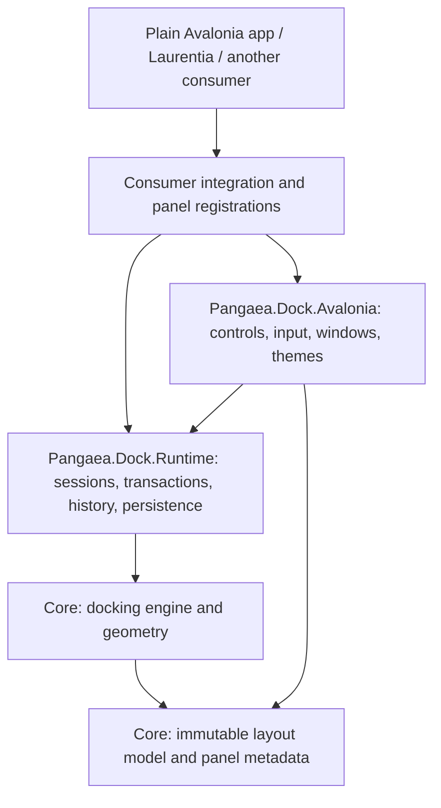

# Pangaea Dock architecture

Design baseline: 2026-10-10. Proposed implementation, not existing APIs.
Update: an evaluation implementation now exists. This document remains the full product target;
see [README.md](README.md), [PACKAGE_README.md](PACKAGE_README.md) and [PROGRESS.md](PROGRESS.md)
for the implemented API, current verification and explicit remaining release work.
Package family: `Pangaea.Dock`. Read [the brief](DESIGN_BRIEF.md) and
[the execution plan](IMPLEMENTATION_PLAN.md) alongside this document.

## 1. Product and package boundary

Build a reusable Avalonia docking library to replace Dock.Avalonia. A consumer registers panel
types, supplies content factories and an initial layout, and places `DockWorkspaceControl` in
its window. The library owns layout manipulation, tab groups, splits, floating hosts, rails,
previews, layout history and workspace persistence. The application owns its documents, file
operations, business rules, content rendering and application shutdown decisions.

Laurentia is the first substantial integration target, not a dependency or part of the public
API. No reference to Laurentia, its palettes, document interfaces, settings, menu descriptors,
undo framework or themes may appear in the shipping library. No reference to Dock packages
may appear there either. Legacy conversion belongs in Laurentia's migration code.

Deliver three packages implementing the brief's four logical layers:

| Package | Responsibilities | Dependencies |
|---|---|---|
| `Pangaea.Dock.Core` | Layout model; pure engine; geometry; content metadata/contracts | BCL only |
| `Pangaea.Dock.Runtime` | Content registry and sessions; transaction coordinator; history retention; JSON/workspace storage contracts | Core |
| `Pangaea.Dock.Avalonia` | Controls, view factories, input, native hosts, automation peers, neutral themes | Runtime, Core, Avalonia |

The content registry is a distinct logical layer even though its contracts live in Core and
its implementation in Runtime. This lets the engine consume immutable type metadata without
knowing how views or services are created. All three packages initially target `net10.0`;
pin the Avalonia package to the verified consumer baseline `11.3.12` for the first build.
This is a baseline, not a claim about the latest supported versions. Additional target frameworks
and Avalonia versions need their own build matrix before being advertised.

No required DI container, MVVM framework, application base class or window superclass. Supply
plain constructors and interfaces. Consumers may wrap them with their preferred DI system.
Package assets use only their own resource namespace and have complete neutral defaults.



Proposed standalone repository layout:

```text
PangaeaDock/
  src/Pangaea.Dock.Core/{Model,Operations,Geometry,Validation,Content}/
  src/Pangaea.Dock.Runtime/{Content,Transactions,History,Persistence,Workspaces}/
  src/Pangaea.Dock.Avalonia/{Controls,Input,Hosting,Automation,Themes}/
  tests/Pangaea.Dock.Core.Tests/
  tests/Pangaea.Dock.Runtime.Tests/
  tests/Pangaea.Dock.Avalonia.Tests/
  tests/Pangaea.Dock.PackageSmoke/
  samples/Pangaea.Dock.Demo/
  docs/decisions/
```

Existing plan documents may stay at repository root. Use a solution, central package version
management, XML API documentation and package README/license metadata. The owner must choose
the distribution license before publishing; do not invent a license or publish as part of building.

## 2. State and identity: location is independent of content

There are four identities, with different lifetimes:

| Identity | Meaning | Example |
|---|---|---|
| `SlotId` | A tab position in a workspace; survives replacement | `slot-17` |
| `PanelTypeId` | Registered editor/tool type; stable across releases | `example.inspector` |
| `PanelInstanceId` | One live panel session; survives movement | `panel-42` |
| `DocumentId` | Optional application-owned backing document | `document-9` |

A slot binds to one panel instance. A panel instance can optionally bind to a document.
Two editor panels can share a document only if the application explicitly supports multiple
views. Duplicating an editor view never implicitly copies the document or its undo history.
Two controls may not share one Avalonia visual instance.

Examples that define the behavior:

- Move a tab: move its slot and binding together; neither panel nor document is recreated.
- Replace With: preserve slot ID, group, index and current geometry; change the panel binding.
- Swap With: exchange the two bindings, retaining both slot locations and both panel instances.
- Duplicate: allocate a new slot and panel instance, using the descriptor's duplication policy.
- Group drag: move all slots in their existing order, preserving the active slot.

### Serializable shape

Use immutable records and immutable collections. Plain value IDs, strings, enums, finite
numbers and versioned JSON payloads are the only persisted values. Do not serialize control
instances, view-model CLR types, delegates, service providers or document file contents.

```text
WorkspaceLayout
  WorkspaceId, Revision, MainHostId, Hosts[], PanelStates[]

HostLayout
  HostId, Kind(Main|Floating), RootNode, Rails[Left,Right,Top,Bottom], Placement?

LayoutNode = SplitNode | TabGroupNode
SplitNode
  NodeId, Axis(Horizontal|Vertical), Children[], Weights[]
TabGroupNode
  NodeId, RegionKey?, Slots[], ActiveSlotId?
DockSlot
  SlotId, PanelInstanceId

RailGroup
  RailGroupId, Slots[], ActiveSlotId, ReturnAnchor, ExpandedExtentDip
PanelState
  PanelInstanceId, PanelTypeId, StateVersion, StatePayload, DocumentReference?
```

`Horizontal` means children laid out left to right. Split weights are positive, finite and
normalized; a split has at least two children. Splitters are derived presentation elements,
not nodes needing independent cleanup. Every host owns a tree; all hosts together form a forest.
Rails own slots outside the tree, never duplicate references to slots in the tree.

Document references are opaque tokens supplied by the consumer, not assumed file paths.
Runtime instances, focused controls, open menus, hover state and auto-hide expansion are transient.
Use a separate runtime state object for them. Layout revision is monotonic at runtime even
during undo; history restores state, never an old revision number.

### Required invariants

1. IDs are unique in the workspace; each live slot has exactly one owner across trees and rails.
2. A live panel instance occupies at most one live slot. Retained history references are separate.
3. Every slot resolves to a registered, missing-type or failed-load panel record.
4. No cycles, orphan children or dangling active-slot IDs. An active slot belongs to its group.
5. No empty ordinary groups or single-child splits after normalization.
6. At least one main host exists; it cannot be removed. An empty main host gets an empty group.
7. Optional consumer-designated regions survive emptying. Laurentia uses a document region;
   the generic library does not require a central document region or prohibit mixed groups.
8. Singleton uniqueness holds across docked panels, rails, floats and retained sessions.
9. All stored dimensions and geometry results are finite. Invalid input is rejected or repaired
   with explicit diagnostics, never silently propagated into layout.

`Normalize` is deterministic and idempotent. Remove empty groups, collapse one-child splits,
and flatten adjacent splits of the same axis by multiplying parent and child weights. Preserve
designated region IDs; do not flatten away a boundary required by a consumer's region policy.
Choose the next active tab to the right of a removed tab, otherwise the preceding tab.
Return an ID-remapping report for focus and return anchors when containers disappear.

## 3. Engine and transaction protocol

All structural changes pass through one engine. Controls never edit tree collections.
The following signatures are contracts to implement; they are not copy-ready shipped APIs:

```csharp
OperationResult Evaluate(
    WorkspaceLayout before, DockOperation operation,
    PanelCatalogSnapshot catalog, LayoutConstraints constraints);

LayoutGeometry Arrange(
    WorkspaceLayout layout, HostGeometrySnapshot hosts,
    PanelCatalogSnapshot catalog, ChromeMetrics metrics);

Task<CommitResult> CommitAsync(
    OperationPlan plan, CancellationToken cancellationToken);
```

`Evaluate` is pure. It returns either a structured rejection or a plan containing the expected
revision, normalized candidate tree, reserved IDs, affected instances, guards/effects required,
and change description. `Arrange` returns group, tab-strip, splitter and content rectangles.
`CommitAsync` belongs to Runtime, not the pure engine.

Supported operation families:

| Operation | Specific contract |
|---|---|
| Move/reorder/merge/split | Explicit source slots, target group or node, side/index; reject moving into own descendant |
| Resize split | Clamp against recursively calculated minima; one history entry per gesture |
| Float/dock/return | Same instances; explicit destination host; remember best-effort return anchor |
| Replace | Preserve target slot and geometry; reject unavailable types/minimum-size conflicts |
| Duplicate | Require explicit duplication capability; insert adjacent to source by default |
| Swap | Validate both destinations and both content constraints before either changes |
| Collapse/pin/restore | Transfer ownership between tree and rail; preserve order and panel state |
| Close slot/group/host | Collect all lifecycle guards before removing any slot |
| Apply/reset workspace | Reconcile live sessions and document views, then publish one transaction |

The transaction sequence is:

1. Validate IDs, capabilities, singleton scope, layout lock, region rules and geometry.
2. Build the complete normalized candidate with the pure engine. Preview uses this candidate.
3. Acquire the per-workspace transaction gate. Verify expected revision and geometry generation.
4. Await consumer guards such as closing the final view of a dirty document. Serialize structural
   operations while this is pending; allow ordinary document editing. Guards must detect a changed
   document revision before considering an earlier save/discard decision valid.
5. Prepare new panel sessions, view resources and hidden floating hosts. Existing sessions remain
   attached until preparation succeeds. Revalidate layout, catalog, capabilities and monitor generation.
6. On the UI dispatcher, detach/attach affected content through the presenter reconciler and publish
   one state change. Suppress external notifications until publication succeeds.
7. Append one history entry; update active/focus services; schedule persistence.
8. On failure before publication, dispose only newly prepared resources and restore any temporarily
   detached views. Emit no history entry and no layout save. Notification failures after publication
   are logged; subscribers cannot retroactively roll back a committed transaction.

File saves are external side effects and cannot be rolled back by docking. If a save succeeds
but a later preparation fails, retain the original layout and the newly saved document state.
Report this accurately. Close-all prompts can similarly save some documents before another
cancels; cancellation guarantees no partial layout closure, not reversal of those file writes.

Queue or reject reentrant layout commands; never recursively mutate the engine from change
notifications. All observable UI/session transitions occur on the UI dispatcher. Background
serialization works only on immutable captured DTOs. Dispose subscriptions explicitly.

## 4. Geometry, dragging and preview equality

The renderer and the preview must use the same `Arrange` result. Do not maintain a second
heuristic rectangle calculator for drag feedback. Measure chrome, evaluate the prospective
operation, normalize, then arrange the candidate. The highlight includes the actual content
region and a tab insertion indicator where relevant.

State machine:

```text
Idle -> Armed -> Dragging -> PreparingCommit -> Committed -> Idle
          |         |              |
          +---------+--------------+-> Cancelled -> Idle
```

- Start only from a tab or group grip after the platform drag threshold. Clicking selects a tab.
- Group dragging has a visible grip/menu route; no mandatory modifier gesture.
- Keep the original tree and live panel at the source while previewing. Render a lightweight ghost,
  never clone a live editor just to represent a drag.
- Candidate precedence: tab insertion strip, explicit outer-host edge zone, group edge zone,
  group center merge. Ties use nearest edge, then a stable side order. Exclude source descendants.
- Initial configurable target defaults: 28 DIP edge band capped at 25% of target dimension;
  8 DIP hysteresis to prevent switching targets near a boundary. On cramped targets offer only
  valid destinations. These values require usability testing, not permanent hard-coded constants.
- Highlight only one outcome, label it briefly (for example, "Split below Inspector"). Do not
  require a permanent directional compass or a hidden key combination.
- Escape, capture loss, source disposal, application shutdown or an invalid drop cancels cleanly.
  Intentional capture transfer by the chosen transport must be distinguished from unexpected loss.
- Releasing outside a host offers floating only when a valid floating preview exists. Releasing
  over another application's window is not an implicit successful dock or an arbitrary new float.
- Layout/size/DPI/catalog changes invalidate the preview. Recompute while dragging. At release,
  commit the last displayed valid plan only if its generations still match; otherwise cancel and
  ask the user to drag again. Never silently commit a different placement than the last preview.
- Keyboard Move opens the same target chooser and uses the same evaluated plans; Enter commits
  and Escape cancels. No second movement algorithm.

### Minimum size calculation

Panel descriptors declare minimum content dimensions in DIP. A tab group's minimum is the
maximum across all of its tabs, plus measured chrome, preventing size jumps on tab activation.
A horizontal split sums widths and splitter extents, and takes maximum height; vertical does
the converse. Allocate weighted space, clamp children hitting minimums, then redistribute the
remainder among unconstrained children. Round at the device scale with deterministic residual
allocation so adjacent rectangles do not develop gaps.

Reject a new split when its candidate cannot meet minima. Replacement or swap must not enlarge
the target or redistribute neighbors; disable incompatible choices with a size explanation.
If the OS shrinks a window below the aggregate minimum, preserve a minimum-sized inner surface
with accessible scrolling and a Reset Layout route. Do not destroy panels, create negative
rectangles or silently rewrite the saved split weights. Display-topology recovery may clamp the
outer window while using this overflow policy inside.

### Cross-window transport

`IDockDragTransport` is an Avalonia-layer seam. Prototype captured-pointer input for in-process
dragging, with a process-local host registry and screen-space hit testing. Verify whether it
supports the required transitions on pinned Avalonia/Windows/macOS. If an OS drag session is
needed across top-levels, use an opaque process-local payload token resolving to the same drag
session; never expose live objects or arbitrary serialized types through OS drag data.

Choose and document one tested transport in WD-00. Do not assume pointer capture implies
cross-window correctness. The engine, target selection and history do not depend on the choice.
Do not mix native window moving and internal docking gestures on the same press.
External file drops remain consumer events and must not be swallowed by internal docking.

## 5. Content registry, session lifetime and interchangeable tabs

`PanelDescriptor` declares:

- Stable type ID, display name, category, search keywords, icon key and optional description.
- Multiplicity: `Multiple`, `SingletonPerWorkspace` or `SingletonPerDocument`.
- Capabilities: duplicate, replace, float, collapse, close, supported document bindings/regions.
- Minimum size and initial preferred size, without Avalonia types.
- Panel-state schema version and a chain of explicit state migrations.

`IPanelFactory` creates a non-visual `IPanelSession`; `IPanelViewFactory` in the Avalonia package
creates the corresponding `Control`. A session exposes an application model plus title/status
updates, capture/restore of view state, visibility/activation callbacks and async disposal.
The consumer supplies document resolution and lifecycle guards through interfaces. A property
grid following the active document is an ordinary consumer registration, not a Core special case.

Runtime tracks ownership leases: visible slot, active transaction, layout history and current
workspace state. Release the actual session only when all required leases are gone. Hidden or
auto-hidden panels are not disposed solely because they lost focus. Expensive panels may suspend
rendering while hidden, without losing their model. Views are lazy; inactive tabs need not all
create their controls. A moved view has one parent at a time; native/GPU views may recreate their
presentation on a new host while preserving session and document identity.

### Exact menu semantics

| Menu action | Behavior |
|---|---|
| Replace With… | Searchable categorized list; indicate open instances; replace in the same slot after guards and preparation |
| Duplicate | New independent panel/view state; document binding shared only by explicit capability; unsupported types explain why |
| Swap With… | Searchable list of existing tabs across all hosts and rails; exchange bindings atomically |
| Move to New Window | Float this slot without recreating its session |
| Close | Remove this slot after any required consumer close guard; available again through Add Panel or layout undo |

All tabs expose Replace With. Only compatible types are enabled; there is no tool/document
restriction baked into the library. A document-backed view may be replaced with a tool, with the
consumer deciding how the last document view is released. A pinned-size incompatible panel is
disabled rather than unexpectedly rearranging the workspace.

An already visible singleton is marked "Already open". Offer Activate Existing and Swap With
Existing as explicit alternatives; do not silently steal it or move another slot. If the singleton
is retained only by history, reactivate that same instance when adding it. Scope per document is
keyed by document ID; an unbound context does not satisfy a document-scoped singleton.

Close removes the tab; Collapse keeps it as a rail entry. This intentionally differs from current
Laurentia palettes marked `CanClose = false`. Laurentia's adapter can initially preserve that old
policy for compatibility, but the completed integration must expose ordinary closable panels and
an Add Panel/menu restoration path, except for app-declared essential content.

Factory failure during user replacement leaves the old panel intact and reports a retryable
error. Failure during startup produces a placeholder in the saved slot with Retry/Replace/Close.
Unknown types preserve their original payload in a missing-panel placeholder so installing the
provider later can restore them. Never use reflection-based arbitrary CLR type activation.

## 6. Layout undo, document lifecycle and focus

Layout history is separate from document history. `Undo Layout` and `Redo Layout` are visible
commands with operation names. The library does not globally intercept Ctrl+Z. Laurentia keeps
Edit Undo/Redo and its field-undo rules unchanged; it maps layout commands into Window > Workspace.

Record structural before/after snapshots with shared immutable subtrees, ID mappings and
session leases. Include move, split, group, float, resize, replace, swap, duplicate, close,
collapse, pin, reset and workspace application. Coalesce one continuous resize or window-move
gesture into one record. Tab activation, hover, focus, temporary rail expansion, automatic saves
and monitor recovery do not add layout history entries.

Undo restores the arrangement and panel bindings, not past document text/model revisions.
Example: replace an editor with an inspector, then undo layout: restore the editor with its
current document and document history. Do not roll back edits made through another view meanwhile.

For closing/replacing the final document view, the application supplies the usual Save/Discard/
Cancel decision and a retention lease if layout undo can reopen that session. On success, the
closed session is dormant and not counted as an open document; it must not receive active-view
updates. Undo releases the dormant status and restores the same current state. A document save
remains saved; a discarded draft can be reopened by undo while its lease exists. It is not
automatically included as an open document in crash recovery after an intentional discard.

Default history bounds: 100 operations and a configurable 64 MiB estimated retained-state budget.
Consumers report expensive session-retention costs. Evict oldest history entries before disposal;
release shared sessions only after their last lease disappears. If a consumer cannot retain or
restore a closed session within policy, report a history boundary explicitly before the close.
Do not promise that arbitrary native application resources can always be resurrected. Laurentia
must implement retention for its ordinary documents before shipping undoable tab closure.

An external permanent document disposal/plugin unload invalidates affected history entries with
a visible reason; ordinary document edits do not. New structural edits clear redo and release its
leases. History is session-local and is not persisted across application restarts.

Maintain focused panel, active tab per group, and the consumer's active document separately.
Focusing a tool must not erase the last active document. Activating a document view updates the
consumer active-document service across all floating hosts. Restore focus by slot ID and optional
consumer bookmark, with tab header as fallback. A stale control reference is never a persisted
focus target.

## 7. Rails, floating hosts and monitor recovery

Collapse transfers a group to an edge rail, recording sibling/ancestor IDs, side, proportions and
last expanded extent. Clicking a rail item opens a temporary overlay over the existing layout;
pinning moves it back into the tree. Return to the nearest surviving recorded ancestor/sibling,
otherwise the specified host edge, otherwise the main host. Evaluate the fallback as a normal
transaction with a preview/description.

Only one auto-hide overlay per host is open by default. Collapse it when focus leaves its content
and owned popups/dialogs; opening a ComboBox, menu or file dialog must not immediately hide it.
Escape closes the overlay and restores focus. Pointer hover alone does not open it by default.
An explicit Pin control and keyboard route are always available. Overlay expansion is transient;
rail placement and resized extent are persisted.

Floating windows remain part of the same workspace and process. "Independent window" means a
separate native top-level, not another application process. Native close applies CloseHost as
one guarded operation; one cancellation keeps the whole host. Provide Dock Back as an alternative.
Closing the main window delegates to application shutdown, including all floating documents.

Persist normal/restored placement, maximized state, saved monitor hints, saved work area in
physical pixels, scale, and normal client size in DIP. Never persist minimized as the restore
state. Screen identity is a best-effort hint rather than a portable guarantee.

Restore algorithm:

1. Match available monitor hint; otherwise largest overlap with saved rectangle; otherwise main
   window's monitor, then primary monitor.
2. Map the saved normalized position within the previous work area to the new work area.
3. Convert DIP size at the target scale, account for current decorations, clamp to work area,
   and ensure the title bar and a usable portion of the window are reachable.
4. Preserve content minima internally with the overflow policy if the available screen is too small.
5. Apply maximization only after normal bounds are established. Recompute on topology changes.

Use explicit pixel/DIP value types and a conversion service. Never apply the primary screen's
scale to all screens or assume desktop coordinates are positive. Monitor repair changes physical
placement, not document contents or user's logical tree. Historical floating bounds are repaired
again on undo when monitor topology has changed.

## 8. Workspaces and persistence

Separate three things:

| Data | Owner and meaning |
|---|---|
| Named workspace definition | Library; reusable arrangement, panel types/state, document-region placeholders |
| Last session layout | Library; most recent arrangement and optional opaque bindings to the app's session |
| Open document restoration and crash recovery | Application; documents, unsaved data, file reopen policy and recovery chooser |

Named layouts are templates, not lists of files to open or close. Saving a named workspace strips
document IDs and records region keys and view placement hints. Applying it retains every currently
open document session: route existing views to matching region keys, otherwise the primary region,
otherwise a new group in the main host. Preserve their order, view state and document history.
Tools are matched by saved instance key/type; create or retain them through the same transaction.
Inactive saved workspace definitions do not hold live singleton instances.

Commands: Save Workspace As, Save Changes, Switch, Duplicate, Rename, Export, Import, Restore Saved,
Reset to App Default. Duplicate allocates new workspace/structural IDs and remaps internal references.
Track each named workspace's saved definition and autosaved working arrangement separately; switching
does not silently overwrite the saved definition. Restore Saved and Reset are undoable applications.
Changes to workspace names/files are management operations, outside arrangement undo.

JSON envelope:

```json
{
  "format": "pangaea-dock",
  "schemaVersion": 1,
  "kind": "session",
  "applicationId": "example.editor",
  "workspaceId": "work-default",
  "revision": 12,
  "layout": { "mainHostId": "host-main", "hosts": [], "panels": [] }
}
```

This envelope illustrates fields, not a valid layout fixture; WD-02 must add complete fixtures.
Node discriminators are explicit (`split`, `tabs`), with an allowlisted parser. Use
System.Text.Json DTOs and version-to-version migrations. Layout schema and panel-state schema
versions are independent. A new palette does not force discarding every old workspace.

Initial import limits: 5 MiB JSON, depth 64, 32 hosts, 2,048 nodes/slots and 256 KiB per panel
payload; configurable with explicit bounded overrides. Reject duplicate IDs, cycles, nonfinite
sizes and excessive structures before creating controls. Unknown panel IDs become placeholders;
unknown node kinds/future layout schemas reject the import without changing the current layout.
Imports never auto-open arbitrary document paths. Portable exports omit document references and
machine-local paths; panels opt in to exporting sanitized view state. Warn if an opted-in custom
payload can include sensitive data; do not claim arbitrary application payloads are safe by default.

`IWorkspaceStore` is injected. Runtime supplies a standalone file-backed implementation with
temporary-sibling writes, atomic replace where supported and last-known-good backup. Laurentia may
adapt its storage policy, but the library cannot call Laurentia's settings or recovery writer.
Document platform/filesystem guarantees; do not claim absolute power-loss durability.

Autosave committed changes after 500 ms of inactivity; flush at workspace switch and accepted
shutdown. Single writer with monotonically increasing generations prevents an older async write
overwriting a newer one. Test with injected scheduler/storage instead of real sleeps. Capture
state without mutating live nodes. Do not save previews or half-completed close transactions.
Use a per-process/session working file and an exclusive update lease for shared named definitions;
concurrent application instances must not silently overwrite one another's workspace files.

Startup: parse -> migrate DTOs -> validate/normalize -> resolve descriptors -> reconcile optional
application session bindings -> prepare sessions -> create hosts. For corrupt sessions, preserve
the original bytes for diagnostics, try last-known-good, then app defaults. Missing documents
produce a recoverable placeholder or are resolved by the application, never a fake clean document.
Show a concise restoration notice with Reset/Retry; keep detailed diagnostics available to the host.

## 9. Presentation, theming and accessibility

Controls: `DockWorkspaceControl`, `DockHostControl`, `DockSplitPanel`, `DockSplitter`,
`DockTabGroup`, `DockTabStrip`, `DockTabHeader`, `DockSlotPresenter`, `DockRail`,
`AutoHidePresenter`, `DockPreviewOverlay`, `PanelTypePicker`, `WorkspaceManagerView`.
Floating native windows are created by `IFloatingHostFactory`, with a default implementation.

Use keyed presenter reconciliation: unchanged slots keep their sessions and visuals. Render only
the active view per group; inactive content can remain cached according to policy. Virtualize the
panel picker and overflow lists. Never rebuild the whole workspace on every pointer move.
Expose templates, resource tokens, command availability and change events as public extension seams.
Do not publish mutable internal collections as an integration API.

Ship neutral light/dark resources named `Pangaea.Dock.*`. Support ThemeVariant inheritance and
runtime resource updates. Token groups: surfaces/text/accent/focus, tab/rail/splitter metrics,
preview fill/outline, spacing and motion. Minimal borders, active tab underline, restrained hover,
contextual group actions. A thin splitter may have a wider hit region. Keyboard focus remains
visible even when hover actions are hidden. Support reduced motion, disabled transparency and
high contrast. Drag preview remains readable without relying on color alone.

Laurentia maps these resources to its semantic DynamicResource brushes and density tokens in
its own style dictionary. Pangaea.Dock ships no Material or Fluent application theme dependency;
provide complete ControlThemes/default resources for its own controls and document the consumer
requirements for standard Avalonia controls used by pickers/dialogs.

Visible routes include Add Panel, every tab menu operation, Move Panel, Resize Split,
Collapse/Pin, Undo/Redo Layout, Workspaces and Reset. Expose command descriptors so hosts can build
native menus. The demo includes a command menu and keyboard-shortcut help; shortcuts are optional
and conflict-checkable. Do not globally steal bare letters or text-field undo.

Keyboard behavior: Tab navigates chrome then content; arrows navigate a tab strip; Enter/Space
activates; a menu key/Shift+F10 opens the tab menu. A configurable panel-cycle command changes focus
between groups/hosts. A keyboard move/resize mode announces target/size and uses Enter/Escape.
Each custom control exposes appropriate automation name, role, selection, expanded/collapsed,
invoke or range-value semantics. Preview status is announced through an accessible status surface.
Test truncation, long/localized titles and right-to-left presentation without changing model order.

## 10. Performance and diagnostic targets

Initial benchmark fixture: 100 panels, 20 groups, 4 hosts, depth up to 10, including lazy expensive
content and long labels. On a recorded reference machine, target p95 engine evaluation plus geometry
below 2 ms and ordinary drag frames within a 16.7 ms budget. These are goals to measure, not promises
or evidence of current performance. Record the machine, scale, backend and actual active controls.

No panel construction, serialization or disk I/O on pointer-move paths. Coalesce pointer updates
to a frame and cache geometry by layout/metrics/host generation. Bound history and dispose drag
subscriptions/overlays on every exit path. Run repeated float/dock/replace cycles to detect retained
windows, controls and subscriptions; memory must settle after history eviction and GC in the test.

Diagnostics identify operation IDs, rejection codes, layout revisions, validation repairs,
restore failures and unresolved panel types. Do not log document contents or arbitrary panel payloads.
Consumers can subscribe to structured diagnostics; the default logger need not depend on a framework.

## 11. Laurentia integration and removal of Dock.Avalonia

Source inspection on 2026-10-10 verified these seams. Paths below are relative to `../Laurentia/`.
They describe current dependencies, not runtime verification of any behavior.

| Current source | Integration work |
|---|---|
| `Laurentia.csproj` | References Avalonia 11.3.12 and Dock 11.3.11.13 packages; serializer 11.3.0.12. Replace only after consumer gates pass |
| `Shell/ShellMainView.axaml` | Contains DockControl bound to Layout; eventually host DockWorkspaceControl |
| `ViewModels/TabbedShellViewModel.cs` | Exposes IRootDock/IFactory, lock and persistence hooks; put behind a Laurentia-owned backend seam |
| `Documents/Interfaces/IDocumentHost.cs` | Inherits IDockable; introduce Dock-independent document-session contract, adapt legacy hosts temporarily |
| `Documents/HistoryBackedDocumentHost.cs` | Inherits DockableBase; migrate its base without losing History, title, path or dirty notifications |
| `ViewModels/DocumentShellViewModel.cs` | Add/remove/active/close/start-page behavior traverses Dock; use consumer document/view services |
| `Documents/Recovery/RecoverySchedule.cs` and `ViewModels/DocumentShellViewModel.Recovery.cs` | Recovery depends on layout foreground enumeration; expose all document views/hosts through the consumer seam |
| `Dock/DocumentDockFactoryBase.cs` and `Dock/TabbedDockFactoryBase.cs` | Map default arrangement and palette descriptors; eliminate app-specific Dock subclasses after migration |
| `Dock/DockLayoutStore.cs` and `Dock/DockLayoutSnapshot.cs` | Legacy JSON/placeholder transplant becomes one-time converter, outside library |
| `Shell/Palettes/PaletteDescriptor.cs` | Map placement/group/order/size/content factories to generic panel registrations |
| `Dock/DocumentTabBehaviors.cs`, `Styles/DocumentTabStyles.axaml`, `Themes/MaterialDock.axaml` | Preserve dirty styling/tooltips/close routing through new header templates and resource mapping |
| `Tools/Laurentia.Tools/New/Templates/` and `Tools/Laurentia.Tools/Check/` | Update generated consumers and compliance rules with the new integration |

Laurentia's proposed `IDockingWorkspaceAdapter` owns initialize, document-view add/remove,
activate, enumerate views across all hosts, panel visibility, reset and layout persistence.
Implement legacy and Pangaea.Dock versions temporarily. This interface belongs to Laurentia;
do not export Laurentia concepts in Pangaea.Dock to make the adapter easier.

Create a Dock-independent Laurentia document contract first; let existing `IDocumentHost` extend
it during migration while still satisfying IDockable. Have shell services use the new contract.
Finally remove IDockable/base-class inheritance and obsolete Dock-specific hooks after all apps
are migrated. This is a planned breaking framework migration; it is not solved by swapping XAML.

Keep separate persistence keys/files for old and new backends. Legacy import is a bounded,
allowlisted conversion of Dock JSON node kinds and known palette IDs to new DTOs, not general CLR
deserialization. Read existing files without overwriting them. Preserve split/order/pinned/floating
state when representable; list unsupported parts and offer a default-layout fallback. Do not read
document contents from Dock JSON or claim it contains reopenable sessions: existing shared code
serializes a document placeholder. Verify old snapshots from each app, including app-owned variants.

Reset/switch must preserve all live document sessions, dirty values and document histories across
floating and main hosts. Start-page presentation is supplied by Laurentia as empty-region content.
Save/Print/Undo resolve the active document even when focus sits in a tool or floating window.
Layout lock starts off (arranging allowed), as it does currently; an explicit host policy preserves
document-tab reordering while tool arrangement is locked. Apply the policy after every restoration.

Build the generic standalone demo first; then integrate a small Laurentia consumer; then validate
Ada3D's GPU/native-content risks and the suite's varied documents. Do not ship only a MiniMdi spike
and declare the replacement complete. Remove Dock packages, themes, subclasses, adapters and
generator references only after every intended consumer is migrated and its checks pass.

## 12. Scope and evidence

Version 1 includes every requirement in the brief: interchangeability, grouping/splitting,
floating, rails, auto-hide, named workspaces, persistence, layout undo and keyboard operation.
The first interactive milestone is intentionally smaller; it is not the finished library.

Out of scope: cross-process docking, plugin downloading, editing application document contents,
cloud workspace sync, collaborative simultaneous layout editing, and a general-purpose DI/MVVM
framework. A plugin registry can register panels, but plugin discovery is a consumer responsibility.

Platform sources checked for architectural feasibility:

- Avalonia documents pointer capture and pointer-relative coordinates. This supports an input
  adapter, but does not prove our proposed cross-window transport works on pinned 11.3.12:
  [Pointer devices](https://docs.avaloniaui.net/docs/input-interaction/pointer).
- Screen APIs expose scaling and work areas; use them behind the monitor adapter:
  [Screen API](https://docs.avaloniaui.net/api/avalonia/platform/screen).
- Custom controls need accessibility peers and exposed semantics:
  [Accessibility](https://docs.avaloniaui.net/docs/app-development/accessibility).
- Avalonia's headless platform supports offscreen control/layout testing; real pixel capture needs
  the rendering configuration described in its guide:
  [Headless testing](https://docs.avaloniaui.net/docs/testing/setting-up-the-headless-platform).

Current online docs may describe newer APIs. Confirm exact API names against the pinned package
and source in WD-00/WD-01. Nothing in this architecture constitutes native-window, multi-monitor,
screen-reader or performance test evidence.
