# Pangaea Dock implementation plan

Planning baseline: 2026-10-10. A working evaluation build now implements substantial parts of
WD-01 through WD-10 and local packaging from WD-12. The original full release gates below remain
the target; they have not all been satisfied. See [PROGRESS.md](PROGRESS.md) for evidence and gaps.
WD-13 through WD-15 (Laurentia integration/migration/removal) are not started.

Read [ARCHITECTURE.md](ARCHITECTURE.md) for required semantics and
[DESIGN_BRIEF.md](DESIGN_BRIEF.md) for the original product requirements.
Pangaea Dock replaces Dock.Avalonia as an independent library; Laurentia integration is a
separate late-stage workstream. A package that only works inside Laurentia fails this plan.

## 1. How an agent should execute this plan

1. Read applicable repository guidance, this plan and the relevant architecture sections.
2. Inspect working changes and current implementation. This document is a baseline, not proof
   that the next session's filesystem or test state is unchanged.
3. Select the first incomplete work package whose dependencies pass. Limit changes to its
   declared scope unless an integration dependency requires an explicitly documented extension.
4. Run relevant existing checks before implementation; distinguish existing failures from new ones.
5. Implement a complete vertical behavior, including error/cancellation paths and public API docs.
6. Run the package's acceptance checks. For UI, render with the real library resources and inspect
   the frames; state assertions alone do not establish appearance or usability.
7. Record files, public contracts, test commands/results, visual evidence and remaining risks in
   `PROGRESS.md` once implementation starts. Mark only actually completed rows as done.
8. Update architecture/decision records when an implementation reveals a necessary design change.
   Do not silently alter singleton, replacement, document-lifecycle or preview semantics.

Project independence is a hard gate: no `../Laurentia` source references in Pangaea Dock projects,
no Laurentia namespaces, no Dock runtime packages, no required Material or ReactiveUI dependency,
no app-specific panel types in shipping assemblies. Examples may opt into an application theme;
the library itself must not install or replace the consumer's application theme.

While working in AdaSuite, use the existing headless UI workflow for automated visual verification.
Do not launch or manipulate the user's desktop to test without the approval required by that
workflow. Native platform verification is a distinct release gate, not a reason to block pure
model development. Do not terminate user-owned apps/debuggers if outputs are locked.

## 2. Delivery milestones

| Milestone | Included work | Demonstrable result |
|---|---|---|
| A — sound foundation | WD-00 to WD-04 | Independent packages, validated model, pure operations and transactional session management |
| B — defining interaction | WD-05 to WD-07 | Standalone demo with exact drag previews, replacement, swap, duplicate and layout undo |
| C — complete workspace behavior | WD-08 to WD-10 | Floating hosts, rails, auto-hide, named workspaces and robust persistence |
| D — reusable library release candidate | WD-11 to WD-12 | Keyboard/automation, platform evidence, package-only consumer and documented public APIs |
| E — Laurentia replacement | WD-13 to WD-15 | Consumers migrated; old Dock dependencies removed only after compatibility gates |

Milestone B is an interactive alpha, not the complete brief. All of C and D are required for
version 1. Milestone E completes the user's replacement in Laurentia.

Dependencies:

```mermaid
flowchart LR
    A[WD-00 Platform investigation] --> F[WD-06 Dragging]
    A --> H[WD-08 Floating]
    B[WD-01 Contracts] --> C[WD-02 Model]
    C --> D[WD-03 Engine]
    D --> E[WD-04 Runtime]
    E --> G[WD-05 Controls]
    G --> F
    F --> I[WD-07 Interchange and undo]
    I --> H
    H --> J[WD-09 Rails]
    J --> K[WD-10 Workspaces]
    K --> L[WD-11 Accessibility and hardening]
    L --> M[WD-12 Packaging]
    M --> N[WD-13 Laurentia adapter]
    N --> O[WD-14 Consumer migration]
    O --> P[WD-15 Remove legacy Dock]
```



Work packages are sized by behavioral scope rather than speculative calendar estimates. The
highest uncertainty is cross-window input/native-content hosting, followed by Laurentia's
document lifetime migration. Resolve these before promising a delivery date.

## 3. Work packages

### WD-00 — Verify the native input and hosting approach

**Depends on:** none. **Scope:** disposable experiment under `samples/` plus a durable decision
record; no Laurentia migration. This is the first technical risk investigation.

Build a minimal two-window Avalonia 11.3.12 probe using a plain colored control. Exercise pointer
capture, screen coordinates, preview overlay ownership, Escape, unexpected capture loss and
release over another top-level. Compare captured-pointer and OS-drag transport only as needed.
Add an explicit file-drop target to verify coexistence with document file dropping. Test native
title-bar movement separately from panel dragging.

Deliver `docs/decisions/0001-drag-transport.md` describing chosen public APIs, event sequences,
known platform limitations, Windows/macOS results and any untested cases. Test 100/150/200% mixed
scales, a negative-coordinate monitor and monitor removal in a controlled native run. Where
hardware/OS is unavailable, record the gap and retain a release gate; do not fabricate completion.

**Acceptance:** cancellation leaves both source and destination unchanged; a drag crosses hosts
without losing its session; drop target coordinates match the target screen; the prototype uses
no global desktop hooks. If no transport supports a required platform, revise the hosting design
before implementing WD-06/WD-08. Pure model work may continue.

### WD-01 — Establish independent projects and contracts

**Depends on:** none. **Scope:** `src/`, `tests/`, `samples/`, solution and build configuration.

Create Core, Runtime and Avalonia projects described in the architecture, with the dependency
direction enforced. Add separate unit/runtime/headless test projects and a minimal standalone
demo. Pin dependencies; no package upgrades to Laurentia as a side effect. Expose typed IDs,
panel metadata, diagnostic result types, scheduler/storage/host seams and lifecycle interfaces.
Keep engine evaluation synchronous/pure and lifecycle preparation asynchronous.

Provide consumer setup documentation showing: register three panels, supply a default layout,
register content/view factories, construct runtime, set the control's workspace, and dispose it.
Include a default floating-window factory and show the override point. Define ownership of every
injected service; do not silently dispose a consumer's service provider.

**Acceptance:** all projects build independently; Core/Runtime load in a console test without
Avalonia; the demo references only Pangaea Dock and its own ordinary Avalonia application packages;
no Laurentia/Dock references in shipping dependency graphs. Public API docs mark ownership and
thread affinity. API examples are compiled by the test solution.

### WD-02 — Implement the immutable model, validation and normalization

**Depends on:** WD-01. **Scope:** Core Model/Validation plus complete JSON fixture definitions.

Implement hosts, split/group nodes, slots, rails, panel records and ID lookup. Implement structural
validation and deterministic normalization with ID remapping. Add immutable catalog snapshots.
Model optional designated regions without making documents mandatory for generic consumers.

**Acceptance cases:** empty main host is usable; duplicate IDs/cycles/dangling active IDs fail;
one-child and same-axis splits normalize correctly; weights preserve relative size; rail ownership
is exclusive; main/designated regions survive emptying; floats with no content are removed;
`Normalize(Normalize(x)) == Normalize(x)`; fixtures round-trip without CLR type names.

Add generated random valid trees and invalid mutations with a printed reproducible seed. Assert
invariants and slot conservation; tests must not simply duplicate the normalization implementation.

### WD-03 — Implement operations and constraint geometry

**Depends on:** WD-02. **Scope:** Core Operations/Geometry.

Implement reorder/move/merge/split, resize, float/return, replace/swap/duplicate, rail transfer,
close and whole-workspace application as evaluated plans. Runtime side effects remain symbolic.
Implement capabilities, singleton/region/lock policies and geometry generations. Implement minima,
weighted allocation, deterministic rounding and overflow behavior.

**Acceptance:** moving within one group handles insertion indexes after removal; moving the last
tab cleans only its old containers; splitting a single group works without preexisting neighbors;
moving a group into itself is rejected; invalid replacement leaves geometry and binding unchanged;
an exact-fit minimum is accepted and a smaller target rejected; finite rectangles tile the usable
area without overlaps/gaps beyond device rounding; a rejected/no-op operation changes no revision.

For operation sequences, prove conservation of instance IDs except explicit create/close, input
immutability, deterministic results and valid normalized output. Add independent hand-calculated
geometry fixtures. Reserve generated IDs in plans so repeated preview does not change identity.

### WD-04 — Implement content runtime and transactional history

**Depends on:** WD-03. **Scope:** Runtime Content/Transactions/History.

Implement registry, session leases, factory preparation, consumer guards, structural command gate,
atomic publication and failure cleanup. Implement bounded layout history, redo invalidation and
coalescing scopes. Use fake sessions/hosts/storage to make failures deterministic. Define runtime
events for committed changes, focus requests and diagnostics.

**Acceptance:** failure on the second prepared panel cleans the first new panel and retains all
old sessions; guard cancellation creates no history; a stale plan rejects; double clicks cannot
run overlapping transactions; reentrant observer commands queue/reject predictably; ordinary
document edits do not roll back with layout undo. Test retained closed panels, reopening a retained
singleton, eviction/disposal exactly once and successful saves followed by canceled layout closure.

Implement configurable retention costs and explicit unsupported-retention results. Do not defer
history ownership until after controls are built: replace/close undo depends on it.

### WD-05 — Render a static workspace and basic commands

**Depends on:** WD-04. **Scope:** Avalonia Controls/Themes and standalone demo.

Implement workspace/host/split/group/tab/slot controls, keyed reconciliation, lazy views and neutral
light/dark resources. Add splitter pointer and keyboard resize through engine plans. Render empty,
failed and missing panels. Add menu commands before drag gestures so operations are usable early.
Provide an explicit Add Panel control and an ordinary non-document demo panel.

**Acceptance:** real arranged rectangles match Core geometry; same instance survives tab activation
and movement; replacement host does not accidentally create duplicate controls; inactive expensive
views stay uncreated until selected; splitter cancellation restores its prior arrangement. Capture
and inspect small/large windows, long titles, empty states, light/dark and scaling frames using real
library resources. No unrelated app style dictionary is needed for docking chrome to render.

### WD-06 — Implement predictive dragging

**Depends on:** WD-00 selected transport and WD-05. **Scope:** Avalonia Input/preview and demo.

Implement the architecture's state machine, threshold, group grip, prioritized target generation,
hysteresis, insertion markers, candidate preview and cancellation. Subscribe once per drag session,
dispose on every exit. Use the engine plan and geometry directly; no pointer-event mutations of the
committed tree. Implement tab overflow scrolling during dragging without changing source selection.

**Acceptance:** all four split edges, tab merge/reorder, whole-group drag, empty targets, invalid
targets, Escape and capture loss. Source tree remains unchanged before drop. For every successful
drop, compare the displayed preview rectangles with committed arranged rectangles (within one
physical pixel). Concurrent resize/DPI/layout change cancels or refreshes before release; it never
silently commits an unseen plan. Drag-over causes zero content factory calls and zero disk writes.

### WD-07 — Complete content interchange and undo UX

**Depends on:** WD-06. **Scope:** picker, tab menus, history command presentation and demo fixtures.

Build searchable categorized Replace With/Add Panel pickers, Duplicate, Swap With and Close.
Include mock text editor/document, inspector singleton, duplicable preview and a deliberately
failing factory in the demo. Show open instances, unavailable size/capability reasons and explicit
Activate/Swap alternatives. Wire Undo Layout/Redo Layout with operation labels and help text.

**Acceptance:** replace preserves slot/group/index and neighbors; both sides of swap validate;
duplicate editor views share document edits but keep independent view state; a singleton can never
be live twice; failed creation leaves original content visible. Test Save/Discard/Cancel for last
document view, undo replacement/closure after later edits and history budget eviction. Verify
ordinary text undo is not stolen. This completes milestone B, not the entire library.

### WD-08 — Ship floating hosts and monitor recovery

**Depends on:** WD-07 and WD-00 platform evidence. **Scope:** Avalonia Hosting, Runtime host effects.

Implement native host factory, process host registry, content transfer, command routing, guarded
host closure, title/decorations and placement conversion. Implement the documented recovery
algorithm behind fakeable monitor topology. Recreate GPU/native presentation where necessary
while preserving session/document identity. Do not assume all controls survive reparenting.

**Acceptance:** tab/group float and dock-back; main-to-float and float-to-float operations; closing
a multi-document float is all-or-none structurally; active document/commands follow focused views;
host creation failure restores source. Fake topology tests cover missing displays, negative origins,
mixed DPI, oversized layouts and maximized/minimized state. Controlled Windows/macOS runs cover
real capture, focus, ownership and native/GPU content. Record untested backends explicitly.

### WD-09 — Ship collapsible rails and auto-hide

**Depends on:** WD-08. **Scope:** Core rail operations, Avalonia rails/overlays/focus ownership.

Implement four edge rails, group collapse, temporary open, pin, resize and return anchors. Distinguish
owned popup/dialog focus from actual departure. Preserve active content/context while retracted.
Allow direct movement of rail tabs/groups using the same target selection.

**Acceptance:** collapse/pin/undo retain IDs and panel state; pin works after original sibling/parent
has disappeared; one overlay per host; ComboBox/context menu/dialog interaction does not retract the
panel prematurely; Escape restores focus; keyboard can open and pin every rail item. Capture real
rail/overlay visuals; for popups inspect focus, state and resolved resources where headless capture
does not include native popup pixels.

### WD-10 — Implement persistence and named workspaces

**Depends on:** WD-09. **Scope:** Runtime Persistence/Workspaces and workspace-management UI.

Implement versioned DTOs/migrations, bounded import, backups, atomic storage, working-session files,
generation-ordered autosave, named definitions and all workspace commands from the architecture.
Make clocks, storage and application document resolution injectable. Apply workspace definitions
through normal evaluated transactions and retention leases.

**Acceptance:** restart round-trip preserves topology/order/rails/floats/view state; capture does
not touch live UI; unknown types retain payloads; future schema rejects without mutation; corrupt
current file recovers from backup/default while preserving diagnostic bytes. Inject partial writes,
write reordering, storage-full errors, cancellation and competing application instances. Verify
workspace switching/reset retains every open dirty document across hosts and histories. Exports
omit local document paths and private state unless explicitly sanitized/opted in. Session reopen
tests use a mock application document resolver; the library must not acquire file-open policy.

### WD-11 — Accessibility, performance and reliability hardening

**Depends on:** WD-10. **Scope:** automation peers, keyboard movement, resource polish, tests.

Complete keyboard parity and automation semantics. Add the architecture's stress fixture, random
operation sequences, long-running session disposal checks and benchmark mode. Include DPI, reduced
motion, high contrast, RTL and long/localized labels. Write a small novice usability script: arrange
two panels, replace one, float/dock, collapse/pin, switch workspace, undo a mistake without tutoring.

**Acceptance:** all operations reachable through visible commands without dragging; automation
tree reports roles/names/selection/expanded state; keyboard target preview and mouse target preview
use the same engine. Measure actual realized controls and p95 times with machine details. Screen
reader testing and novice usability observation remain separate from automated test success; record
results and fix observed failures. Unverified claims cannot satisfy the release gate.

### WD-12 — Verify consumable packages and document the public API

**Depends on:** WD-11. **Scope:** packaging/CI/docs, package-only smoke consumer.

Pack all three projects into a local feed. Restore a standalone Avalonia consumer from those
packages in an isolated directory without AdaSuite project references. Demonstrate registration,
default layout, styles, persistence and floating hosts with both plain view models and an optional
MVVM sample. Compile every documented sample. Audit public types for leaked implementation details.

**Acceptance:** clean package-only restore/build/run/headless smoke; resources and templates included
in nupkgs; Core/Runtime dependency graphs contain no UI framework; Avalonia package graph contains
no Laurentia, Dock, Material or ReactiveUI requirement. License metadata is owner-selected before
publication; namespace availability is checked then. Pin compatible dependency bounds and test them.
Document configuration, extension points, state migration, ownership, errors, limitations and the
platform support matrix. Pack locally; publishing is not part of this work package.

### WD-13 — Add Laurentia's integration seam and pilot

**Depends on:** WD-12. **Scope:** Laurentia-owned adapter and one small consumer. Read Laurentia's
canonical rules/context before changes; Pangaea Dock remains independent.

Introduce a Dock-independent document-session contract and `IDockingWorkspaceAdapter` as described
in architecture section 11. Adapt legacy Dock-backed hosts so existing apps still run. Implement
Pangaea panel/document registration, empty-region start page, semantic token mapping, menu commands,
active document, field undo compatibility, recovery enumeration, layout lock and persistence hooks.
Use a startup backend choice, not hot-switching live control trees between engines.

Pilot in MiniMdi or a freshly generated small Laurentia app after checking its applicable rules.
Implement a bounded legacy import outside the library. Keep old persisted layout data intact and
new state in a distinct namespace. Failed migration offers explicit fallback and diagnostics.

**Acceptance:** open/edit/save/close/cancel/undo documents on both backends; new backend reset/switch
preserves all document identities and dirty histories; floating documents participate in recovery;
dirty markers, full-path tooltips, empty start page and menu/shortcut behavior retain existing
semantics. All unrelated apps continue on the old backend until explicitly migrated.

### WD-14 — Migrate the suite consumers

**Depends on:** WD-13. **Scope:** one app at a time plus generator/checker updates.

Inventory actual current app code before edits; sibling implementations already differ. Suggested
order: AdaPad (text and field undo), Ada3D (native/GPU view risk), AdaDraw, AdaPaint (complex tools
and custom persistence), then Zaibatsu and Star Wars (document/palette/data-template variations).
If the WD-08 GPU investigation fails, resolve that blocker before migrating Ada3D.

For each app: replace Dock-specific document subclasses and factory wiring, translate default
palette descriptors, migrate direct tree/active-document queries, replace app-specific persistence
and reset code, verify all menu behaviors, and supply panel capabilities/lifecycle adapters.
Do not copy app-specific implementations into Pangaea Dock. Migrate `laurentia new` and `check`
together; verify a freshly generated app using the new backend.

**Acceptance per app:** existing functional/convention checks; new docking adapter tests; inspected
headless frames; saved old-layout fixture import; main/floating dirty-document guard/reset/recovery;
save-in-flight edits stay dirty; document undo and layout undo remain distinct. Preserve untouched
legacy snapshots for rollback until the app's native verification passes. Update app guidance as
the implementation changes; do not claim suite completion from one passing pilot.

### WD-15 — Remove the legacy dependency and complete the replacement

**Depends on:** every WD-14 consumer passed, WD-12 native support gates complete.
**Scope:** Laurentia/suite references, obsolete compatibility paths and documentation.

Remove Dock package references, old theme includes, direct IDockable contracts/base classes,
obsolete factory classes and the temporary backend. Keep the bounded JSON importer as long as
the documented upgrade policy requires it, with no Dock runtime dependency. Remove obsolete
generator checks and templates only as their replacements land. Do not delete user settings or
third-party reference checkouts.

**Acceptance:** suite source/package graph has no runtime Dock dependencies; no app still needs
the legacy backend to open its documents; all relevant existing and new checks pass; native platform
matrix is complete for advertised support. Pangaea Dock still packs/restores independently in a
clean consumer. Provide release notes, migration instructions and known limitations with evidence.

## 4. Validation strategy and commands

The current evaluation build uses two executable assertion harnesses. From the PangaeaDock root:

```powershell
.\Verify.ps1
.\Pack-And-Smoke.ps1 -Offline
```

`Verify.ps1` builds and runs `tests/Pangaea.Dock.Tests` and `tests/Pangaea.Dock.Harness` with real
Skia frame capture. These replace the three originally proposed test-project names in this preview.
`Pack-And-Smoke.ps1` packs Core, Runtime and Avalonia before restoring an isolated package-only
consumer. Remove `-Offline` on a new machine that needs to download dependencies.

Unit tests prove pure semantics. Runtime tests prove lifecycle/failure behavior. Headless tests
prove control layout, command routing and rendered appearance using real templates. Native tests
prove platform input, focus, ownership, display topology and screen-reader behavior. Usability
sessions prove discoverability. These categories are complementary and cannot replace each other.

For Laurentia changes, run the current app's orientation/harness command and:

```powershell
dotnet run --project Laurentia/Tools/Laurentia.Tools -- check <app-root>
```

from the AdaSuite root. Resolve actual per-app harness commands from current guidance; some use
`verify`, others `rules` or dedicated test projects. Never infer success from historical counts.

## 5. Requirement traceability and release gates

| Requirement | Primary work packages | Required evidence |
|---|---|---|
| Natural direct drag and forgiving targets | 00, 06, 11 | Cancel/threshold/hysteresis tests and novice interaction |
| Preview equals final result | 03, 06, 08 | Candidate-vs-arranged geometry, including cross-DPI hosts |
| Tab/group split, merge and float | 03, 06, 08 | Same-instance movement, normalization and native host tests |
| Position independent of content | 02, 04, 07 | Slot identity/geometry invariant through replace and swap |
| Search/category/open-state picker | 07, 11 | Realized searchable UI, keyboard and singleton tests |
| Duplicate and singleton policies | 04, 07 | Lifetime/identity/factory-failure tests |
| Collapse, auto-hide and pin | 09 | Rails, return anchors, owned-popup focus and persistence tests |
| Central workspace and nested splits | 02, 03, 05 | Generic mixed layout and optional designated-region fixtures |
| Named workspaces/export/restore | 10 | Dirty-document preservation, portable export and write-failure tests |
| Multi-monitor recovery | 00, 08, 10 | Fake topology matrix plus real Windows/macOS evidence |
| Theme, DPI and restrained chrome | 05, 11 | Inspected light/dark/scaled/high-contrast/reduced-motion frames |
| Transactional layout/normalization/minima | 02, 03, 04 | Generated invariants, independent geometry and failure injection |
| Undo accidental layout changes | 04, 07, 10 | Round trips, close retention, redo clearing and separate document history |
| Missing/corrupt/obsolete layout recovery | 10, 13 | Unknown types, schema migration and legacy fixture tests |
| Keyboard and assistive technology | 06, 09, 11 | Full command parity, automation and native reader verification |
| Independent reusable package | 01, 12 | Package-only clean consumer with no Laurentia/Dock references |
| Actual Laurentia replacement | 13, 14, 15 | All intended consumers migrated; legacy runtime dependency absent |

The product is ready only when all rows have evidence. A build, a static screenshot or a successful
serializer round-trip alone cannot establish correct docking behavior.

## 6. Review checkpoints and decisions still requiring evidence

- After WD-00: select one drag transport with platform evidence. Keep its uncertainty outside Core.
- After WD-03: review identity, invariants and operation contracts before binding controls to them.
- After WD-07: review the defining drag/replace experience; tune target metrics with observed use.
- After WD-08: confirm native/GPU content transfer and mixed-DPI behavior before consumer migration.
- After WD-12: review package-only consumption and documentation, not only the in-repo demo.
- Before WD-15: verify all consumer migration and rollback evidence before deleting compatibility code.

Owner decisions not needed to start: distribution license, publication account/package availability,
and exact optional default shortcuts. Native platform availability is an evidence constraint; it
must be visible in release status. These do not justify stalling model/runtime implementation.

## 7. Reusable agent assignment

```text
Implement work package WD-XX in PangaeaDock/IMPLEMENTATION_PLAN.md.
Read the applicable repository guidance and PangaeaDock/ARCHITECTURE.md first.
Verify its dependencies against actual code and test results; the planning baseline is not proof
that any prerequisite is implemented. Preserve uncommitted work.

Pangaea Dock is an independent package family replacing Dock.Avalonia. Do not add dependencies on
Laurentia, Dock, Material.Avalonia or ReactiveUI to the shipping projects. Laurentia integration
belongs in Laurentia and is not in scope unless WD-XX explicitly says so.

Implement the behavior and failure paths listed in WD-XX, plus its necessary meaningful tests.
Use one engine path for pointer and keyboard commands. Preserve slot/content/document identity
separation, transactional previews and separate document/layout histories.

Record exact checks, inspected UI artifacts where applicable, unresolved native/platform gaps and
any necessary design changes. Update the work package status and implementation PROGRESS.md.
Do not mark completion based only on compilation or mock state assertions. Do not publish packages
or remove the legacy Laurentia backend outside their designated work packages.
```
