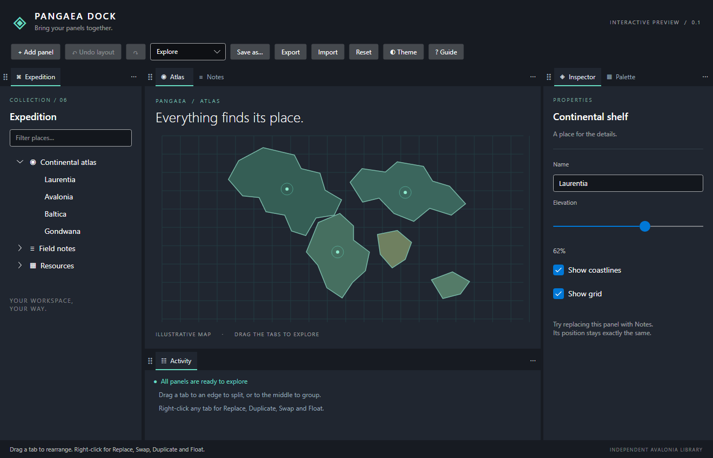
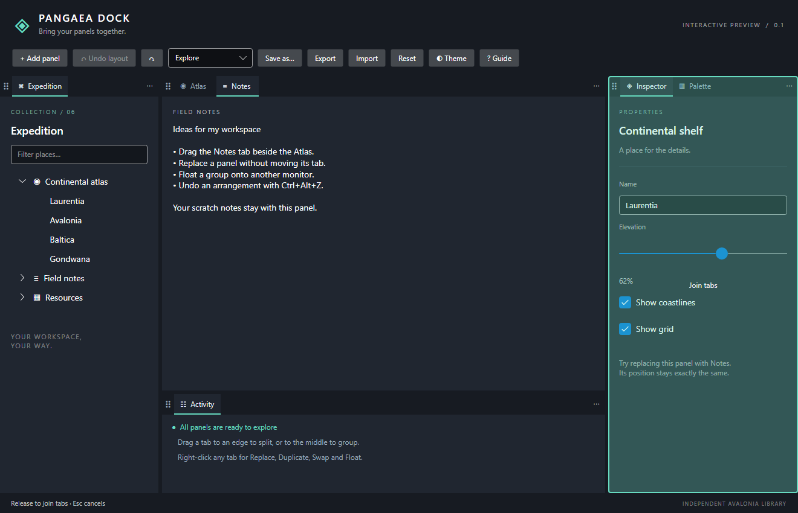
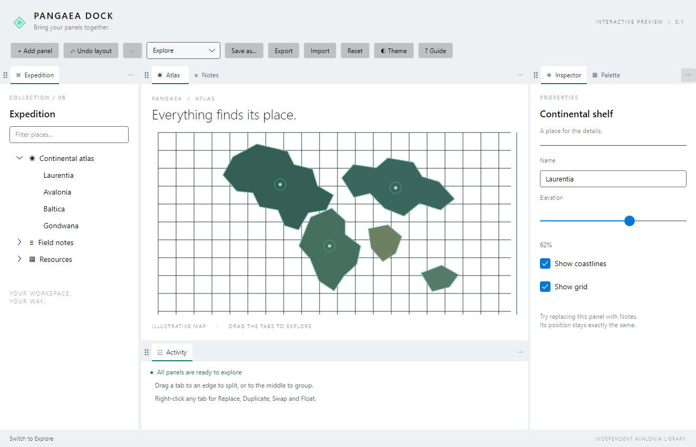

# Pangaea Dock

**Bring your panels together.** An independent docking library for [Avalonia 11](https://avaloniaui.net/):
tabs, splits, floating windows, border trays, layout undo and data-only persistence.

[](https://github.com/majeric/PangaeaDock/actions/workflows/ci.yml)
[](LICENSE)



> **Status: 0.1 evaluation preview.** It works and is tested, but the API may change before 1.0 and
> some production gates (native multi-monitor/macOS qualification, accessibility certification,
> storage migrations) are still open. See [Project status](#project-status).

## Features

- **Tabs and splits** — drag a tab to the centre of a group to join it, or to an edge to split.
  The preview shows the exact result; Escape cancels.
- **Floating windows** — move any tab to its own native window and back again.
- **Border trays** — collapse a group to any of the four edges; open it temporarily or pin it.
- **Interchangeable panels** — Replace, Duplicate, Swap and Close from the tab menu; replacement
  keeps the tab exactly where it was. A searchable picker adds panels.
- **Layout undo/redo** — Ctrl+Alt+Z / Ctrl+Alt+Y. Closed panels come back with their live state.
- **Transactional engine** — every change is a pure, revision-checked plan; async close guards can
  veto it, and failures roll back.
- **Data-only persistence** — JSON layouts with atomic writes, last-good backup and validated import.
  Your panels supply their own state; nothing is serialized by reflection.
- **Light and dark** — neutral chrome that sits on your app's existing Avalonia theme.
- **Few dependencies** — just Avalonia. No Dock.Avalonia, Material.Avalonia or ReactiveUI.

| Drag preview | Light theme |
|---|---|
|  |  |

## Install

Packages are attached to each [GitHub release](https://github.com/majeric/PangaeaDock/releases)
(they are not on NuGet.org). Download the `.nupkg` files into a folder and add it as a package source:

```powershell
dotnet nuget add source C:\path\to\packages --name PangaeaDock
dotnet add package Pangaea.Dock.Avalonia --version 0.1.0
```

`Pangaea.Dock.Avalonia` brings in `Pangaea.Dock.Runtime` and `Pangaea.Dock.Core`.
Requires .NET 10 and Avalonia 11.3.

## Quick start

```csharp
using Avalonia.Controls;
using Pangaea.Dock.Avalonia;
using Pangaea.Dock.Core;
using Pangaea.Dock.Runtime;

// 1. Register panel types: a descriptor plus a factory for the nonvisual session.
var panels = new PanelRegistry();
panels.Register(new PanelDescriptor("notes", "Notes"), _ => new NotesSession());

// 2. Register a view factory for each panel type.
var views = new PanelViewRegistry();
views.Register("notes", session => new NotesView((NotesSession)session));

// 3. Create the workspace, add a panel, and show it.
var workspace = new DockWorkspace(panels);
await workspace.AddAsync("notes", workspace.Layout.Groups.First().Id);
window.Content = new DockWorkspaceControl(workspace, views);

// Your types:
sealed class NotesSession : PanelSession
{
    public override string CaptureState() => "{}";              // panel view state as JSON
    public override void RestoreState(string json, int version) { }
}
sealed class NotesView(NotesSession session) : UserControl { /* ... */ }
```

Create everything on the UI thread. Dispose the `DockWorkspaceControl` before the `DockWorkspace`.
The [Usage Guide](docs/USAGE.md) covers commands, sessions, close guards, floating windows, trays,
undo, persistence, theming and app integration; [PACKAGE_README.md](PACKAGE_README.md) is the short version; see
[`samples/Pangaea.Dock.Demo`](samples/Pangaea.Dock.Demo) for a complete application.

## Packages

| Package | Responsibility |
|---|---|
| `Pangaea.Dock.Core` | Immutable layout model, pure operations, validation, normalization and geometry. No UI dependency. |
| `Pangaea.Dock.Runtime` | Panel registry, sessions, guards, transaction commit, undo/redo and JSON storage. |
| `Pangaea.Dock.Avalonia` | Controls, drag previews, menus, picker, border trays and floating windows. |

## Run the demo

On Windows, double-click **[Run-Demo.cmd](Run-Demo.cmd)** (builds and launches the Release demo), or:

```powershell
dotnet run --project samples/Pangaea.Dock.Demo -c Release
```

Things to try:

1. Drag **Notes** onto the centre of **Inspector** to make a tabbed group.
2. Drag a tab near a panel edge and release to split. Escape cancels.
3. Drag the dotted grip to move a whole group, or drag a separator to resize.
4. Right-click a tab for **Replace**, **Duplicate**, **Swap**, **Move to New Window** or **Close**.
5. Use a group's **⋯** menu to collapse it to a tray; click its icon to open it, **↗** pins it.
6. Switch **Explore / Focus**, edit Notes, switch back — live panel state follows the panel.
7. **Undo layout / Redo** (Ctrl+Alt+Z/Y), including after replacing, closing or resetting.
8. Save a named arrangement, export/import it, and switch to the light theme.

The demo stores its session under `%LOCALAPPDATA%\PangaeaDock\Demo`. Exports include the demo's
scratch notes; they are layout snapshots with panel state, not sanitized portable templates.

## Build and test

Requires the [.NET 10 SDK](https://dotnet.microsoft.com/download).

```powershell
./Verify.ps1               # Release build, core/runtime checks, headless UI checks
./Pack-And-Smoke.ps1       # pack all three libraries; build and render a package-only consumer
```

- `tests/Pangaea.Dock.Tests` — model, engine, runtime and storage checks.
- `tests/Pangaea.Dock.Harness` — drives the real demo through Avalonia.Headless with Skia
  rendering and writes frames to `artifacts/ui/`. No visible window, mouse or keyboard is used.
- `tests/Pangaea.Dock.PackageSmoke` — restored only from the packed `.nupkg` files; intentionally
  outside the solution. `-Offline` restores from the local package cache only.

Both test projects are console programs that exit non-zero on failure, not `dotnet test` adapters.
Packages land in `artifacts/packages/`.

## Project status

0.1.0 is an evaluation preview. Known limits:

- Cross-window dragging is exercised headlessly; native Windows multi-monitor, mixed-DPI and macOS
  interaction still need qualification. Dropping on bare desktop does not yet create a floating
  window — use **Move to New Window**.
- Keyboard routes and accessible names exist; custom automation peers, high-contrast and
  screen-reader certification, and reduced-motion policy are open.
- History is bounded by operation count, not memory. Document lifetime, saving and recovery belong
  to the consuming application.
- Storage is schema 1 with validation, atomic writes and backup; migrations, sanitized portable
  exports and multi-process coordination are not done.
- Group chrome is rebuilt on commit (panel controls are retained); finer focus preservation, drop
  hysteresis and large-workspace performance are work items.

Details and evidence: [PROGRESS.md](PROGRESS.md). Release history: [CHANGELOG.md](CHANGELOG.md).
Planned API changes for 0.2: [API review](docs/API_REVIEW.md).

## Design documents

1. [Design brief](DESIGN_BRIEF.md) — the original requirements, preserved verbatim.
2. [Architecture](ARCHITECTURE.md) — boundaries, identities, contracts, interaction semantics,
   persistence, reliability and consumer integration. Describes the intended complete product.
3. [Implementation plan](IMPLEMENTATION_PLAN.md) — work packages, acceptance tests and migration gates.
4. [Orientation](ORIENTATION.md) — where things live in the source, and how to verify changes.
5. [Progress](PROGRESS.md) — what is implemented, the evidence, and remaining gaps.
6. [Decision records](docs/decisions/) — e.g. [drag transport](docs/decisions/0001-drag-transport.md).

The public API in source and [PACKAGE_README.md](PACKAGE_README.md) describes this release;
don't infer completion of a work package from a similarly named control.

## License

[MIT](LICENSE) © 2026 Jeremy Denton
